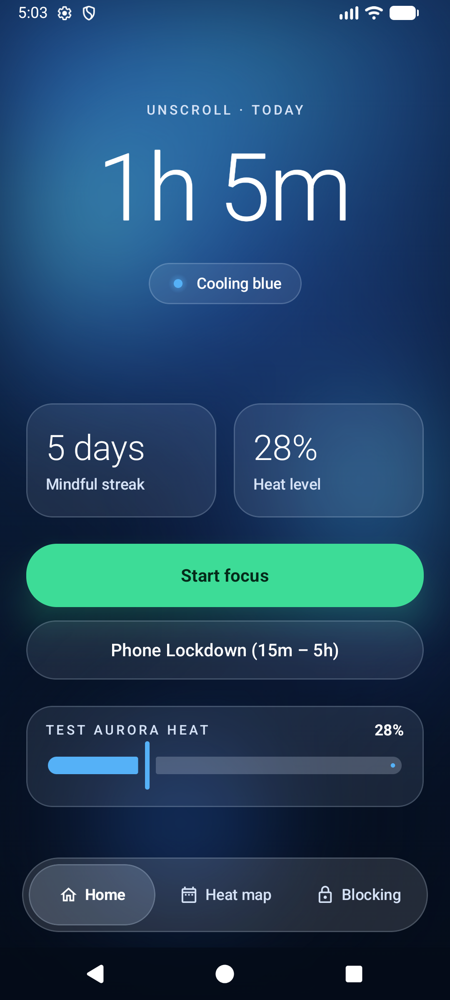
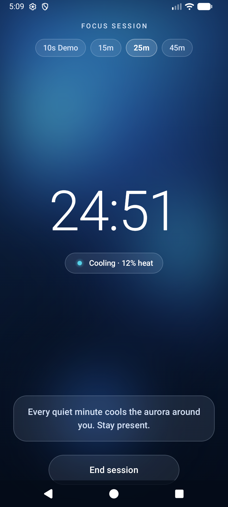
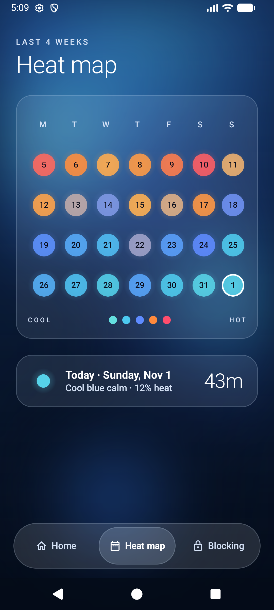
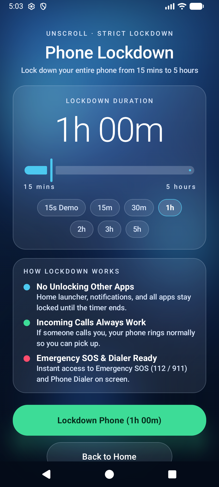
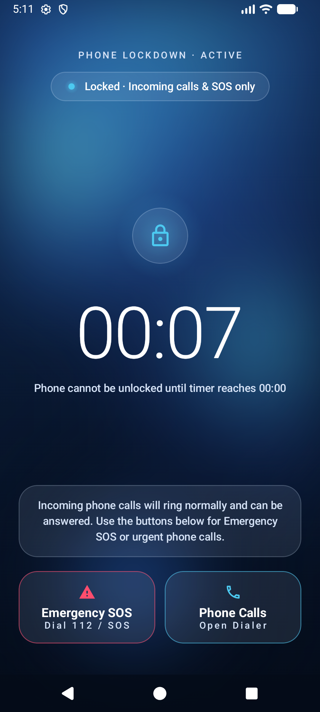
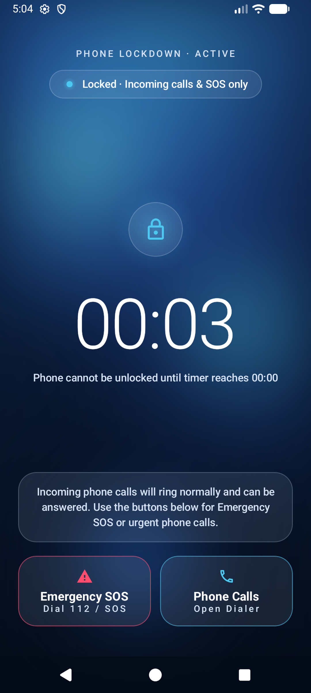
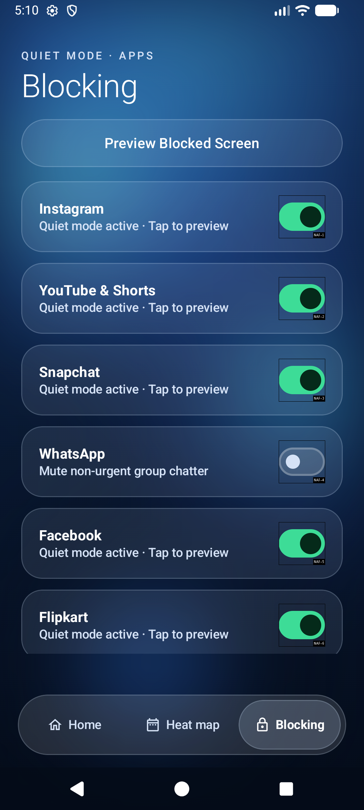
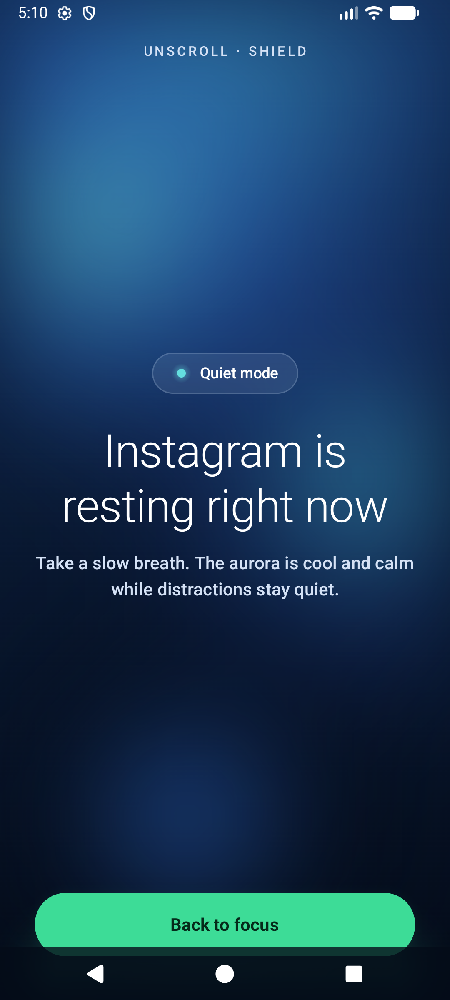

# UnScroll — Scroll Less. Live More.

**UnScroll** is a mindful Android digital wellbeing application built with **Kotlin, Jetpack Compose, Material 3, and Android System Services**. Instead of using harsh red warnings or guilt-driven charts, UnScroll visualizes your daily screen habits as an atmospheric **Thermal Aurora (Blue Light & Shade)** that cools down as you step away from infinite-scroll feeds — and includes a strict **Phone Lockdown Mode (15 mins to 5 hours)** that locks down your entire device while keeping **Incoming Calls** and **Emergency SOS (112 / 911)** accessible.

---

## 💡 The Idea & Core Philosophy

Most screen-time blockers fail for one of two reasons:
1. **They rely on shame and harsh friction**, which causes users to disable them out of frustration.
2. **Or they are too easy to dismiss** when willpower drops during late-night doomscrolling.

**UnScroll** bridges both worlds:
- **Calm Everyday Mindfulness ("Thermal Aurora — Blue Light & Shade"):** Your phone's background is a living atmospheric sky (`AuroraBackground.kt`). High screen time warms the sky toward crimson/amber; mindful focus cools it into deep sapphire, sky-blue, and ice-cyan mist (`#4CC9F0` → `#64DFDF`).
- **Unbreakable Commitment When Needed ("Phone Lockdown Mode: 15m – 5h"):** When you truly need to disconnect (studying, sleeping, deep work, family time), you can lock down your phone for **15 minutes up to 5 hours**. During Lockdown:
  - **You cannot exit to the home launcher or unlock other apps** until the countdown reaches `00:00`.
  - **Incoming phone calls still ring normally** so you never miss an important call.
  - **Emergency SOS (`112` / `911`) and the Phone Dialer** remain directly accessible on the Lockdown screen at all times.
  - **Reboot-proof:** If the device restarts mid-lockdown, `BootReceiver` automatically restores the Lockdown overlay for the remaining duration.

---

## 📱 App Screenshots (Live Emulator Verification)

### 1. Home Screen, Focus Session & 4-Week Heat Map
| Home Screen (`Blue Light & Shade`) | Focus Session (`Cooling Timer`) | 4-Week Heat Map (`28-Day Grid`) |
| :---: | :---: | :---: |
|  |  |  |

### 2. Strict Phone Lockdown Mode (`15 mins` to `5 hours`)
| Lockdown Setup (`15m – 5h` Slider & Presets) | Active Lockdown (`Calls & SOS Only`) | Lockdown Complete (`Device Unlocked`) |
| :---: | :---: | :---: |
|  |  |  |

### 3. App Blocking & Quiet Mode Shield
| App Blocking (`Glass Toggles`) | Quiet Mode Blocked Screen (`Calm Shield`) |
| :---: | :---: |
|  |  |

---

## ✨ Key Features

### 1. Thermal Aurora Home Screen (`HomeScreen.kt`)
- **Atmospheric Blue Light & Shade Background (`AuroraBackground.kt`):** Full-screen vertical gradient (`#102A52` → `#091933` → `#040B18`) with three drifting, unbounded blurred light spheres (`BlurredEdgeTreatment.Unbounded`).
- **86sp Light Screen-Time Readout:** Displays today's screen time in `Manrope Light (300)` paired with a glowing status `GlassChip` (*Cool blue calm*, *Cooling blue*, *Moderate heat*, *Warm heat*, *High heat*).
- **Glass Stat Cards:** Side-by-side translucent cards displaying **Mindful streak** (`5 days`) and **Heat level** (`%`).
- **Quick Actions:** One-tap **Start focus** button (`#3DDC97` with soft green glow) and **Phone Lockdown (15m – 5h)** glass button.
- **Interactive Heat Tester:** Built-in slider (`0%` to `100%`) to preview how the aurora responds across the entire thermal spectrum.

### 2. Phone Lockdown Mode — 15 Mins to 5 Hours (`LockdownScreen.kt`)
- **Flexible Duration (`15m` to `5h`):** Continuous slider (`15` to `300` minutes in 5-minute increments) plus quick preset pills (`15m`, `30m`, `1h`, `2h`, `3h`, `5h`, and `15s Demo` for quick verification).
- **Non-Cancelable Countdown (`ThermalActiveLockdownScreen`):**
  - Blocks hardware and gesture Back navigation via `BackHandler(enabled = !isCompleted)`.
  - `AppBlockerService` intercepts any attempt to open the home launcher, settings, browsers, or social apps and immediately re-displays the Lockdown overlay.
- **Incoming Calls & Emergency SOS Allowlist:**
  - `AppBlockerService.isPackageAllowedDuringLockdown(...)` allowlists system dialers, in-call UI (`incallui`, `dialer`, `telecom`, `com.android.phone`), and emergency packages (`emergency`, `safetyhub`).
  - Dedicated **Emergency SOS (`Dial 112 / SOS`)** and **Phone Calls (`Open Dialer`)** buttons on the active Lockdown screen.

### 3. Focus Session Screen (`FocusSessionScreen.kt`)
- **100sp Countdown Timer:** Minimalist distraction-free countdown (`10s Demo`, `15m`, `25m`, `45m`) that progressively cools the aurora as time passes.
- **Completion Shimmer:** Gentle pulsing aurora shimmer when the session finishes.

### 4. 4-Week Heat Map (`HeatMapScreen.kt`)
- **7-Column × 4-Week Grid (`M T W T F S S`):** 28 glowing circular day nodes (`34dp`) colored by each day's usage intensity, with a crisp white ring highlighting **Today**.
- **Interactive Day Inspector:** Tapping any day updates the bottom `GlassCard` with that day's date, thermal label, and total screen time.

### 5. App Blocking & Quiet Mode (`AppBlockingScreen.kt` & `AppBlockerService.java`)
- **Selective App Quieting:** Toggleable glass rows for **Instagram, YouTube & Shorts, Snapchat, WhatsApp, Facebook, Flipkart, Swiggy, and Zomato** backed by Room (`AppDao`).
- **YouTube Shorts Detection:** Inspects the Accessibility node tree in real time to detect YouTube Shorts reel containers even when regular YouTube videos are allowed.
- **Calm Quiet Mode Screen (`ThermalBlockedScreen`):** Greets the user with *"Instagram is resting right now"* and a green **Back to focus** button instead of harsh error dialogs.

---

## 🎨 Design System: "Thermal Aurora — Blue Light & Shade"

| Token | Hex | Role |
| :--- | :--- | :--- |
| `AuroraTopBlueLight` | `#102A52` | Upper atmospheric blue light |
| `AuroraMidBlueShade` | `#091933` | Mid-tone sapphire shade |
| `AuroraDeepAbyssShade` | `#040B18` | Deep bottom midnight shade |
| `ThermalCalmMint` (`0.0`) | `#64DFDF` | Coolest ice cyan-blue mist |
| `ThermalCoolTeal` (`0.2`) | `#4CC9F0` | Luminous sky-blue glow |
| `ThermalSoftViolet` (`0.4`) | `#5E8BFF` | Cool sapphire blue |
| `ThermalAmberGold` (`0.6`) | `#FFB454` | Moderate warm amber |
| `ThermalWarmOrange` (`0.8`) | `#FF8A3D` | Warm orange |
| `ThermalHotCrimson` (`1.0`) | `#FF4D6D` | High-usage crimson-coral |
| `AuroraGreenButton` | `#3DDC97` | Primary action button fill (`#052A1A` text) |
| `GlassSurfaceFill` | `#1ACCE3FF` | Translucent ice-blue glass card fill (~10% opacity) |
| `GlassBorderStroke` | `#33D8EAFF` | 1dp glass card border (~20% opacity) |

---

## 🧪 Testing & Verification

All features are verified by both **automated JUnit unit tests** (`UnScrollTestSuite.kt`) and **live Android Emulator UI tests** (`Medium Phone API 37`).

- **Run Automated Unit Tests:**
  ```bash
  ./gradlew testDebugUnitTest
  ```
- **Latest Test Suite Result:** `9 passed, 0 skipped, 0 failed` (`100% pass rate`)
- **Full Test Report & Screenshots:** See [`docs/TEST_REPORT.md`](docs/TEST_REPORT.md)
- **Technical Architecture:** See [`docs/ARCHITECTURE.md`](docs/ARCHITECTURE.md)

| Test Case | Target Component | Status |
| :--- | :--- | :---: |
| `lockdownDurationClamping_enforces15MinutesTo5HoursRange` | `SessionManager.clampLockdownMinutes` | ✅ PASS |
| `lockdownCallAndEmergencyAllowlist_allowsPhoneCallsAndEmergencyDialers` | `AppBlockerService.isPackageAllowedDuringLockdown` | ✅ PASS |
| `lockdownCallAndEmergencyAllowlist_blocksSocialAppsLaunchersAndBrowsers` | `AppBlockerService.isPackageAllowedDuringLockdown` | ✅ PASS |
| `thermalPaletteInterpolation_mapsCoolBlueToHotCrimson` | `Color.kt` (`thermalColorForHeat`) | ✅ PASS |
| `thermalShortLabels_returnAccessibleLabelsAcrossHeatSpectrum` | `Color.kt` (`thermalShortLabelForHeat`) | ✅ PASS |
| `dayHeatRecord_formatsHoursAndMinutesCorrectly` | `DayHeatRecord.formattedTotal` | ✅ PASS |
| `blockableAppItem_togglesBlockedStateImmutably` | `BlockableAppItem` | ✅ PASS |
| `emulatorScreenshots_arePresentAndValidPngFiles` | `docs/screenshots/*.png` | ✅ PASS |
| `addition_isCorrect` | `ExampleUnitTest` | ✅ PASS |

---

## 🏗️ Project Structure

```text
app/src/main/java/com/example/unscroll/
├── MainActivity.java                 # Hosts Jetpack Compose ThermalAuroraTheme & CoolingPlanetApp
├── BlockOverlayActivity.java         # Hosts Quiet Mode Blocked screen & strict Phone Lockdown overlay
├── ui/
│   ├── CoolingPlanetApp.kt           # Root state, tab transitions, Focus & Lockdown overlays
│   ├── AuroraBackground.kt           # Blue Light & Shade gradient + drifting unbounded blur spheres
│   ├── GlassComponents.kt            # GlassCard, GlassChip, AuroraPrimaryButton, GlassFloatingBottomBar
│   ├── HomeScreen.kt                 # Today's screen time, streak, heat tester, Focus & Lockdown CTAs
│   ├── FocusSessionScreen.kt         # 100sp cooling countdown timer & completion shimmer
│   ├── LockdownScreen.kt             # Phone Lockdown setup (15m–5h) & non-cancelable active screen
│   ├── HeatMapScreen.kt              # 4-week (28-day) glowing circle grid & day inspector card
│   ├── AppBlockingScreen.kt          # Toggleable app list & Quiet Mode Blocked screen
│   └── theme/
│       ├── Color.kt                  # Blue Light & Shade + 6-stop Thermal Aurora palette
│       ├── Type.kt                   # Downloadable Google Font Manrope (Light 300, Medium 500, Bold 700)
│       └── Theme.kt                  # Material 3 dark color scheme & 24dp shape tokens
├── service/
│   ├── AppBlockerService.java        # AccessibilityService for Lockdown allowlist, app blocking & Shorts
│   └── NotificationSnoozerService.java # NotificationListenerService for e-commerce promo snoozing
├── session/
│   └── SessionManager.java           # Persists Focus Session & Phone Lockdown timers across reboots
├── receiver/
│   └── BootReceiver.java             # Restores active Phone Lockdown & Focus sessions on device boot
├── db/                               # Room SQLite database (`AppDatabase`, DAOs, Entities)
├── usage/                            # `UsageStatsHelper` querying Android `UsageStatsManager`
├── streak/                           # `StreakTracker` for mindful daily streaks
└── worker/                           # `UsageSyncWorker` periodic background sync
```

---

## 🚀 Getting Started

1. **Clone the repository:**
   ```bash
   git clone https://github.com/mohanarevarapu-commits/UnScroll.git
   cd UnScroll
   ```
2. **Build the debug APK:**
   ```bash
   ./gradlew assembleDebug
   ```
3. **Run unit tests:**
   ```bash
   ./gradlew testDebugUnitTest
   ```
4. **Install on a connected Android device or emulator:**
   ```bash
   ./gradlew installDebug
   ```
