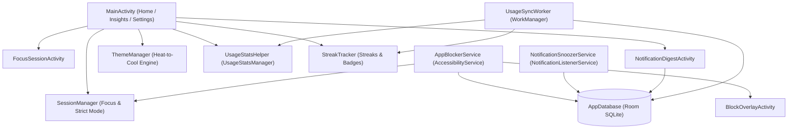

# UnScroll Technical Architecture

This document describes the internal architecture, background services, custom Canvas views, and local persistence layer of **UnScroll**.

---

## 1. High-Level System Flow

---

## 2. Local Persistence (`com.example.unscroll.db`)

UnScroll stores all user preferences, quieted apps, focus sessions, and snoozed notifications locally on the device using **Room (`AppDatabase`)**:

| Entity | DAO | Purpose |
| :--- | :--- | :--- |
| `AppEntity` | `AppDao` | Stores package name, app name, block status (`isBlocked`), notification snooze status (`isSnoozed`), and time limits. |
| `DailyUsageEntity` | `DailyUsageDao` | Records daily total screen time, saved time, and thermal state history for insights and heat map visualization. |
| `FocusSessionEntity` | `SessionDao` | Logs completed and active focus sessions (`startTime`, `durationMinutes`, `completed`). |
| `BlockedNotificationEntity` | `NotificationDao` | Stores intercepted promotional notifications (`packageName`, `title`, `text`, `timestamp`) for the Quiet Digest. |
| `ReflectionEntity` | `ReflectionDao` | Saves user reflections entered on `BlockOverlayActivity` when pausing before opening a quieted app. |

---

## 3. Background Services & Workers

### `AppBlockerService` (`AccessibilityService`)
- Listens to `TYPE_WINDOW_STATE_CHANGED` and `TYPE_WINDOW_CONTENT_CHANGED` events.
- Checks whether the foreground package is marked as quieted in `AppDao` or if an active focus session (`SessionManager`) is running.
- Detects short-form video surfaces (such as YouTube Shorts reel containers) and launches `BlockOverlayActivity` with a gentle reminder.

### `NotificationSnoozerService` (`NotificationListenerService`)
- Intercepts incoming status bar notifications in real time.
- Filters notifications from e-commerce and delivery apps (Flipkart, Myntra, Swiggy, Zomato, Zepto, Blinkit) or user-selected snoozed apps.
- Cancels the noisy alert and persists the payload into `BlockedNotificationEntity` so the user can review it calmly in `NotificationDigestActivity`.

### `UsageSyncWorker` (`WorkManager`)
- Runs periodically in the background to aggregate foreground screen time via `UsageStatsHelper`, update `DailyUsageEntity`, and evaluate daily streak continuity via `StreakTracker`.

---

## 4. Custom Canvas Views & Design Engine

### `ThemeManager`
- Computes a normalized usage ratio (`currentUsageMs / dailyLimitMs`).
- Maps the ratio across the 5-stage **Heat-to-Cool** palette (`#5E81AC` Coolest Blue → `#8AB89E` Mint → `#E9C46A` Pale Yellow → `#F4A261` Amber → `#E76F51` Red-Orange).
- Always provides a human-readable accessibility status label alongside any color calculation.

### `CircularProgressView`
- Renders the **Sunrise Progress Ring** on the Home screen.
- Uses a `12dp` rounded stroke on a warm sand track (`#EDE8E1`) with a dynamic sweep gradient matching the current Heat-to-Cool state.
- Displays remaining focus time in bold serif typography and sets a dynamic `contentDescription` for TalkBack accessibility.

### `GardenGrowingTreeView`
- Procedural botanical canvas view with 5 growth stages (`Seed` → `Sprout` → `Sapling` → `Young Tree` → `Full Canopy`).
- Animates continuously during active focus sessions in `FocusSessionActivity` and renders weekly growth in `InsightsHelper`.

### `HeatMapView`
- Draws a **7-day × 4-time-of-day** (`Morn`, `Noon`, `Eve`, `Night`) matrix of rounded cells colored by screen-time intensity (`Cool` → `Mid` → `Warm` → `Hot`), complete with an accessible legend.
