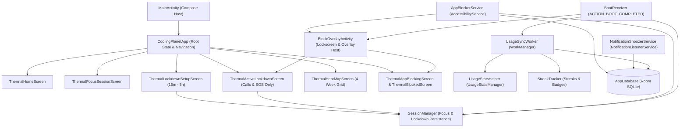
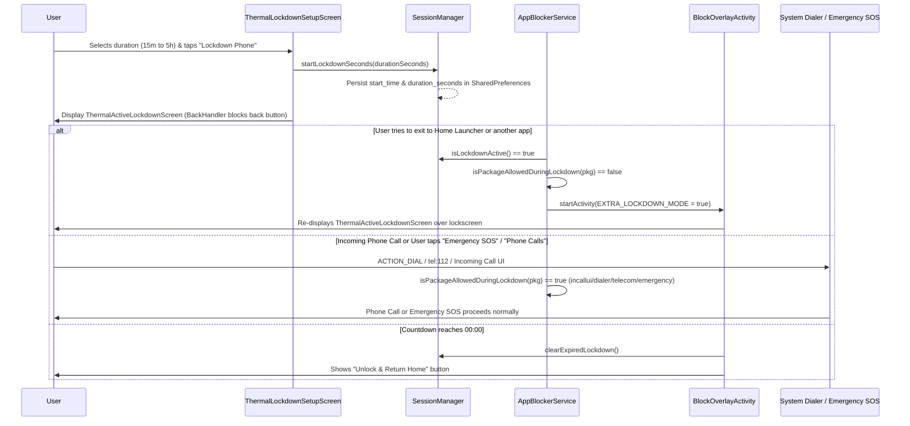

# UnScroll Technical Architecture

This document describes the internal architecture, Jetpack Compose **Thermal Aurora (Blue Light & Shade)** UI layer, **Phone Lockdown Mode (`15 mins` to `5 hours`)**, background system services, and local Room persistence layer of **UnScroll**.

---

## 1. High-Level System Flow

---

## 2. Phone Lockdown Mode Architecture (`15 mins` to `5 hours`)

### Key Safeguards in Lockdown Mode
1. **Duration Clamping (`SessionManager.clampLockdownMinutes`):** Enforces the `15` to `300` minute (`15m` – `5h`) range for standard lockdown sessions while also supporting a `15s Demo` mode for quick testing.
2. **Call & Emergency Allowlist (`AppBlockerService.isPackageAllowedDuringLockdown`):**
   - Permits `incallui`, `dialer`, `telecom`, `emergency`, `safetyhub`, `com.android.phone`, and `com.android.systemui`.
   - Intercepts all other foreground packages (launchers, browsers, social apps, settings) on `TYPE_WINDOW_STATE_CHANGED` and routes back to `BlockOverlayActivity` in Lockdown Mode.
3. **Lockscreen & Reboot Persistence (`BlockOverlayActivity` & `BootReceiver`):**
   - `MainActivity` and `BlockOverlayActivity` enable `setShowWhenLocked(true)` and `setTurnScreenOn(true)` on API 27+.
   - `BootReceiver` checks `sessionManager.isLockdownActive()` on `ACTION_BOOT_COMPLETED` and immediately launches `BlockOverlayActivity` if a lockdown timer is still active.

---

## 3. Jetpack Compose UI Layer ("Thermal Aurora — Blue Light & Shade")

- **[`AuroraBackground.kt`](../app/src/main/java/com/example/unscroll/ui/AuroraBackground.kt):**
  - Renders a full-screen vertical gradient (`#102A52` → `#091933` → `#040B18`) with three slowly drifting light spheres.
  - Uses `Modifier.blur(..., edgeTreatment = BlurredEdgeTreatment.Unbounded)` and explicit pixel-radius `Canvas` radial gradients (`radius = size.minDimension / 2f`) so soft glows never clip against rectangular bounds.
- **[`GlassComponents.kt`](../app/src/main/java/com/example/unscroll/ui/GlassComponents.kt):**
  - Provides `GlassCard`, `GlassChip`, `AuroraPrimaryButton`, `GlassOutlineButton`, and `GlassFloatingBottomBar` (`68dp` height, `34dp` corner radius, minimum `48dp` touch targets).

---

## 4. Local Persistence (`com.example.unscroll.db`)

UnScroll stores all user preferences, quieted apps, focus sessions, and snoozed notifications locally on the device using **Room (`AppDatabase`)**:

| Entity | DAO | Purpose |
| :--- | :--- | :--- |
| `AppEntity` | `AppDao` | Stores package name, app name, block status (`isBlocked`), notification snooze status (`isSnoozed`), and time limits. |
| `DailyUsageEntity` | `DailyUsageDao` | Records daily total screen time, saved time, and thermal state history for insights and heat map visualization. |
| `FocusSessionEntity` | `SessionDao` | Logs completed and active focus sessions (`startTime`, `durationMinutes`, `completed`). |
| `BlockedNotificationEntity` | `NotificationDao` | Stores intercepted promotional notifications (`packageName`, `title`, `text`, `timestamp`) for the Quiet Digest. |
| `ReflectionEntity` | `ReflectionDao` | Saves user reflections entered when pausing before opening a quieted app. |
