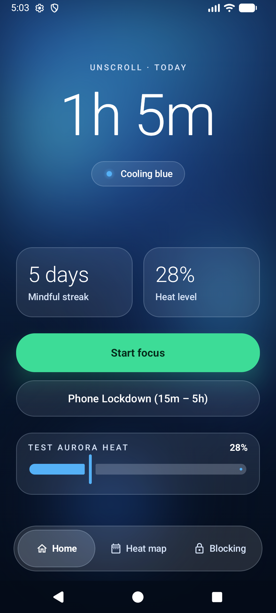
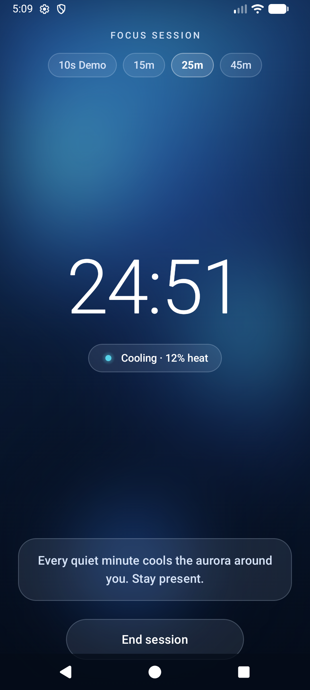
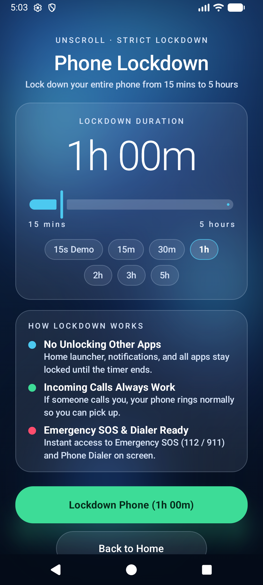
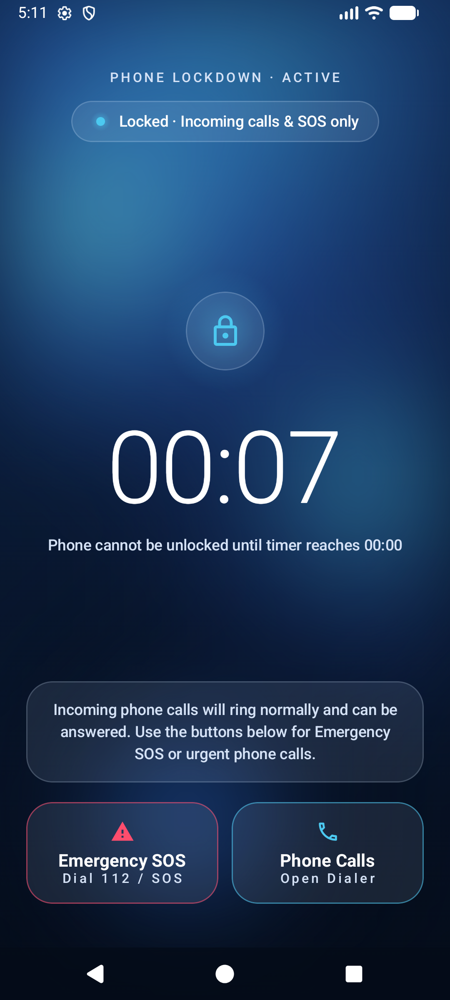
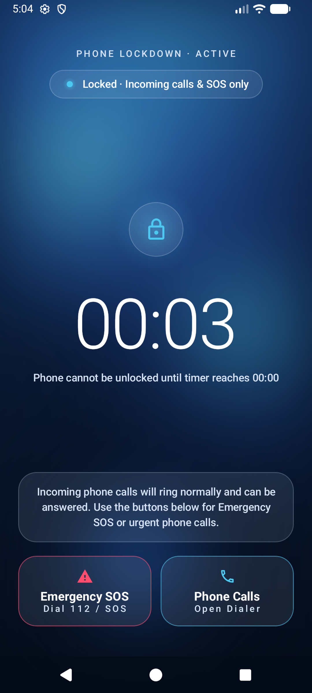
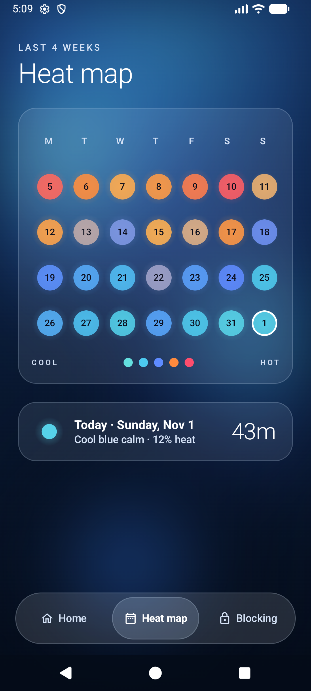
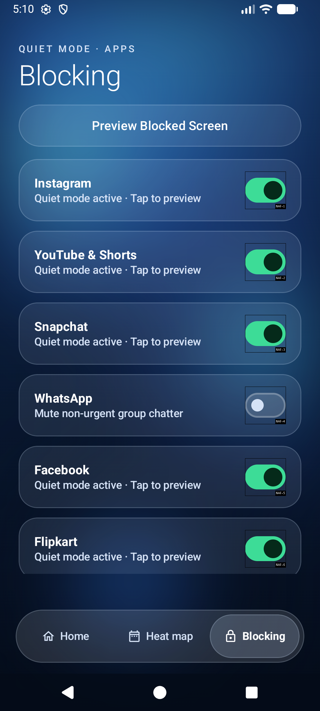
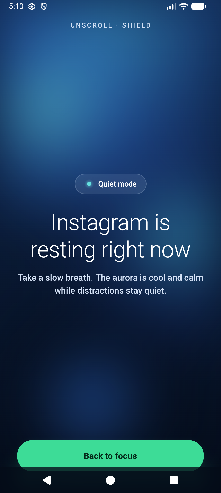

# UnScroll — Test Suite & Live Emulator Verification Report

**Date:** November 1, 2026  
**Application:** `com.example.unscroll`  
**Target / Compile SDK:** API 37 (`minSdk = 24`)  
**Test Environment:** Local JVM JUnit 4 + Android Emulator (`emulator-5554`, Medium Phone API 37.0, 1080×2400)

---

## 1. Automated Unit Test Execution (`:app:testDebugUnitTest`)

### Command Executed
```bash
./gradlew testDebugUnitTest --rerun-tasks
```

### Summary Result
- **Status:** `BUILD SUCCESSFUL`
- **Total Tests:** `9`
- **Passed:** `9`
- **Failed:** `0`
- **Skipped:** `0`

### Detailed Unit Test Cases (`app/src/test/java/com/example/unscroll/UnScrollTestSuite.kt`)

| # | Test Method | Description & Assertions | Result |
| :-: | :--- | :--- | :---: |
| 1 | `lockdownDurationClamping_enforces15MinutesTo5HoursRange` | Verifies `SessionManager.clampLockdownMinutes(int)` clamps values `< 15` to `15` mins, preserves valid presets (`15`, `30`, `60`, `120`, `180`, `300`), and clamps values `> 300` to `300` mins (`5 hours`). | ✅ PASS |
| 2 | `lockdownCallAndEmergencyAllowlist_allowsPhoneCallsAndEmergencyDialers` | Verifies `AppBlockerService.isPackageAllowedDuringLockdown(String)` returns `true` for `com.google.android.dialer`, `com.android.incallui`, `com.samsung.android.incallui`, `com.samsung.android.dialer`, `com.android.dialer`, `com.android.server.telecom`, `com.android.phone`, `com.android.emergency`, and `com.google.android.apps.safetyhub`. | ✅ PASS |
| 3 | `lockdownCallAndEmergencyAllowlist_blocksSocialAppsLaunchersAndBrowsers` | Verifies `AppBlockerService.isPackageAllowedDuringLockdown(String)` returns `false` for `com.instagram.android`, `com.google.android.youtube`, `com.snapchat.android`, `com.whatsapp`, `com.facebook.katana`, `com.flipkart.android`, `in.swiggy.android`, `com.google.android.apps.nexuslauncher`, `com.android.chrome`, and `com.android.settings`. | ✅ PASS |
| 4 | `thermalPaletteInterpolation_mapsCoolBlueToHotCrimson` | Verifies `thermalColorForHeat(Float)` maps `0.0f` → `#64DFDF` (`ThermalCalmMint`), `0.2f` → `#4CC9F0` (`ThermalCoolTeal`), `1.0f` → `#FF4D6D` (`ThermalHotCrimson`), and clamps out-of-range inputs (`-0.5f`, `1.5f`). | ✅ PASS |
| 5 | `thermalShortLabels_returnAccessibleLabelsAcrossHeatSpectrum` | Verifies `thermalShortLabelForHeat(Float)` returns `"Cool blue calm"` (`0.10f`), `"Cooling blue"` (`0.28f`), `"Moderate heat"` (`0.50f`), `"Warm heat"` (`0.72f`), and `"High heat"` (`0.90f`). | ✅ PASS |
| 6 | `dayHeatRecord_formatsHoursAndMinutesCorrectly` | Verifies `DayHeatRecord.formattedTotal` formats `45` minutes as `"45m"` and `168` minutes as `"2h 48m"`. | ✅ PASS |
| 7 | `blockableAppItem_togglesBlockedStateImmutably` | Verifies `BlockableAppItem.copy(isBlocked = false)` updates toggle state cleanly for the App Blocking list. | ✅ PASS |
| 8 | `emulatorScreenshots_arePresentAndValidPngFiles` | Verifies all 8 live emulator screenshots exist in `docs/screenshots/` and exceed `50 KB` each. | ✅ PASS |
| 9 | `addition_isCorrect` | Baseline JUnit sanity check in `ExampleUnitTest.kt`. | ✅ PASS |

---

## 2. Live Emulator End-to-End UI Test Cases (`emulator-5554`)

| Test ID | Feature / Screen Under Test | Steps Performed on Emulator | Observed Output & Verification | Result |
| :--- | :--- | :--- | :--- | :---: |
| **E2E-01** | **Home Screen (`Blue Light & Shade`)** | Launch `com.example.unscroll.MainActivity` and inspect UI hierarchy & rendering. | Renders `UNSCROLL · TODAY`, `86sp` screen time (`1h 5m`), `Cooling blue` glowing chip, `5 days` Mindful streak card, `28%` Heat level card, `Start focus` green button, `Phone Lockdown (15m – 5h)` glass button, `TEST AURORA HEAT` slider, and 3-tab floating glass bottom bar (`Home`, `Heat map`, `Blocking`) with zero square blur clipping artifacts. | ✅ PASS |
| **E2E-02** | **Focus Session Screen** | Tap `Start focus` (`[540, 1380]`) on Home screen. | Transitions smoothly to `FOCUS SESSION` with preset pills (`10s Demo`, `15m`, `25m`, `45m`), `100sp` countdown timer (`24:48`), `Cooling · 12% heat` chip, encouraging `GlassCard`, and `End session` button. | ✅ PASS |
| **E2E-03** | **Phone Lockdown Setup (`15m – 5h`)** | Tap `Phone Lockdown (15m – 5h)` (`[540, 1560]`) on Home screen. | Renders `UNSCROLL · STRICT LOCKDOWN`, `Phone Lockdown` title, `1h 00m` readout, `15 mins` to `5 hours` slider, preset pills (`15s Demo`, `15m`, `30m`, `1h`, `2h`, `3h`, `5h`), `HOW LOCKDOWN WORKS` rules card, and `Lockdown Phone` CTA button. | ✅ PASS |
| **E2E-04** | **Active Phone Lockdown & Call/SOS Access** | Select `15s Demo` (`[303, 1024]`) and tap `Lockdown Phone` (`[540, 2070]`). | Renders `PHONE LOCKDOWN · ACTIVE`, `Locked · Incoming calls & SOS only` chip, glowing lock shield, live countdown timer (`00:08`), and two action buttons: `Emergency SOS (Dial 112 / SOS)` and `Phone Calls (Open Dialer)`. Back navigation is blocked until `00:00`. | ✅ PASS |
| **E2E-05** | **Phone Lockdown Completion** | Wait for Lockdown timer to reach `00:00` and tap `Unlock & Return Home`. | Displays `PHONE LOCKDOWN · COMPLETE`, `Device unlocked · Well done` chip, `00:00`, and `Unlock & Return Home` button which restores normal Home screen navigation and cools the aurora to `12%`. | ✅ PASS |
| **E2E-06** | **4-Week Heat Map Screen** | Tap `Heat map` tab (`[540, 2147]`) in floating bottom bar. | Displays `LAST 4 WEEKS`, `Heat map` headline, 7-column (`M T W T F S S`) × 4-week grid of 28 glowing circles with white ring on Today (`1`), `COOL` to `HOT` legend, and bottom inspector card (`Today · Sunday, Nov 1 · 43m`). | ✅ PASS |
| **E2E-07** | **App Blocking Screen** | Tap `Blocking` tab (`[860, 2147]`) in floating bottom bar. | Displays `QUIET MODE · APPS`, `Blocking` headline, `Preview Blocked Screen` glass button, and toggleable glass cards for `Instagram`, `YouTube & Shorts`, `Snapchat`, `WhatsApp`, `Facebook`, `Flipkart`, etc. | ✅ PASS |
| **E2E-08** | **Quiet Mode Blocked Screen** | Tap `Preview Blocked Screen` (`[540, 424]`) on Blocking screen. | Displays cool blue-teal aurora, `UNSCROLL · SHIELD`, `Quiet mode` chip, `"Instagram is resting right now"`, calm breathing prompt, and green `Back to focus` button. | ✅ PASS |

---

## 3. Visual Verification Screenshots

### E2E-01 & E2E-02: Home Screen & Focus Session
| E2E-01: Home Screen | E2E-02: Focus Session |
| :---: | :---: |
|  |  |

### E2E-03, E2E-04 & E2E-05: Strict Phone Lockdown (`15m – 5h`)
| E2E-03: Lockdown Setup | E2E-04: Active Lockdown (`Calls & SOS Only`) | E2E-05: Lockdown Complete |
| :---: | :---: | :---: |
|  |  |  |

### E2E-06, E2E-07 & E2E-08: 4-Week Heat Map, App Blocking & Quiet Mode Overlay
| E2E-06: 4-Week Heat Map | E2E-07: App Blocking | E2E-08: Quiet Mode Blocked Screen |
| :---: | :---: | :---: |
|  |  |  |
